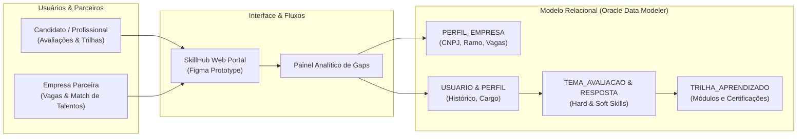

# SkillHub — Plataforma de Mapeamento de Competências e Conexão de Talentos

**Autor:** Renan Santa Rosa Xavier — RM566997 | 🌐 **Portfólio:** [renan-xavier.vercel.app](https://renan-xavier.vercel.app)  
**Instituição:** FIAP — Análise e Desenvolvimento de Sistemas

---

## 📌 Visão Geral do Projeto

O **SkillHub** é uma plataforma concebida para a **Global Solution FIAP**, voltada à identificação de lacunas de competências técnicas (*hard skills*) e comportamentais (*soft skills*) em profissionais, conectando-os a trilhas de capacitação personalizadas e oportunidades em empresas parceiras.

O projeto reúne a modelagem relacional completa (Lógica e Física em 3FN) desenvolvida no **Oracle SQL Developer Data Modeler**, documentação corporativa e protótipo interativo de alta fidelidade no **Figma**.

---

## 🎬 Demonstração do Sistema

### Vídeo de Apresentação (Pitch Global Solution)
Confira o pitch completo do projeto no YouTube:

> 🔗 **Assistir no YouTube:** [Projeto SkillHub — Global Solution FIAP](https://www.youtube.com/watch?v=YsNf0N--3XQ)

### Protótipos das Telas do Sistema
| Tela Inicial & Acesso | Painel e Trilhas de Competências | Avaliação e Perfil Profissional |
| :---: | :---: | :---: |
|  |  |  |

---

## 🏛️ Arquitetura e Modelagem de Dados

O ecossistema integra a experiência dos usuários e parceiros corporativos à base relacional corporativa:

### Modelo Lógico Relacional (3FN)

### Modelo Físico Relacional

---

## 🛠️ Tecnologias Utilizadas

| Tecnologia | Finalidade no Projeto |
| :--- | :--- |
| **Oracle SQL Developer Data Modeler** | Construção das entidades relacionais, normalização em 3FN, definição de chaves primárias/estrangeiras e dicionário de dados. |
| **Oracle SQL** | Scripts DDL para criação de tabelas, constraints de integridade referencial e consultas analíticas. |
| **Figma** | Prototipagem navegável em alta fidelidade, arquitetura de informação e Design System com acessibilidade. |
| **YouTube** | Hospedagem da apresentação em vídeo do pitch executivo da solução. |

---

## 📑 Estrutura dos Arquivos do Repositório

| Arquivo / Pasta | Conteúdo |
| :--- | :--- |
| [`SQL do Proj SkillHub.dmd`](SQL%20do%20Proj%20SkillHub.dmd) | Arquivo de projeto nativo do Oracle SQL Developer Data Modeler contendo todo o esquema relacional. |
| [`Protótipo SkillHub.pdf`](Prot%C3%B3tipo%20SkillHub.pdf) | Documentação completa com as telas navegáveis e fluxo do usuário. |
| [`Projeto SkillHub Modelo Logico.pdf`](Projeto%20SkillHub%20Modelo%20Logico.pdf) | Diagrama ampliado do modelo conceitual/lógico com cardinalidades. |
| [`Projeto SkillHub Modelo Fisco.pdf`](Projeto%20SkillHub%20Modelo%20Fisco.pdf) | Diagrama físico com tipos de dados, tamanhos e constraints. |
| [`Apresentação do Projeto SkillHub.pdf.pdf`](Apresenta%C3%A7%C3%A3o%20do%20Projeto%20SkillHub.pdf.pdf) | Slides da defesa da Global Solution perante a banca acadêmica da FIAP. |
