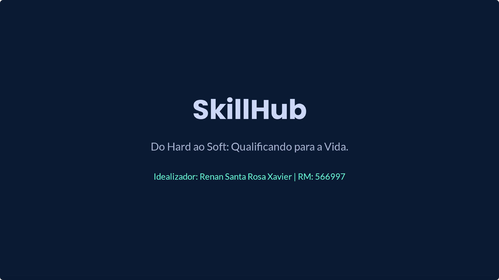
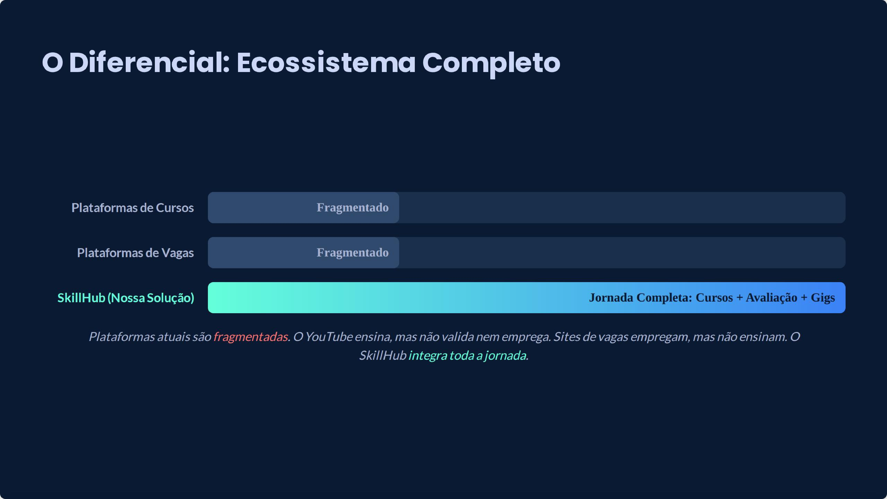
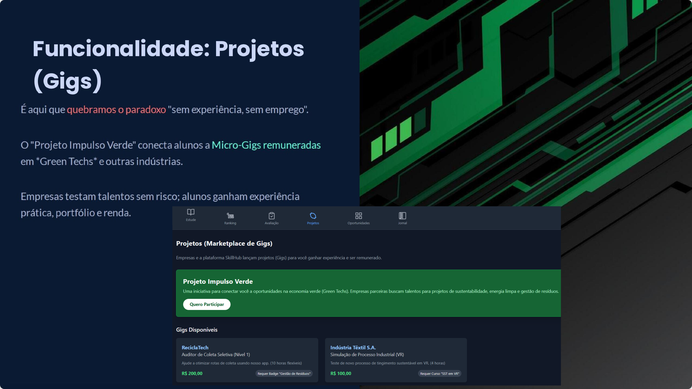
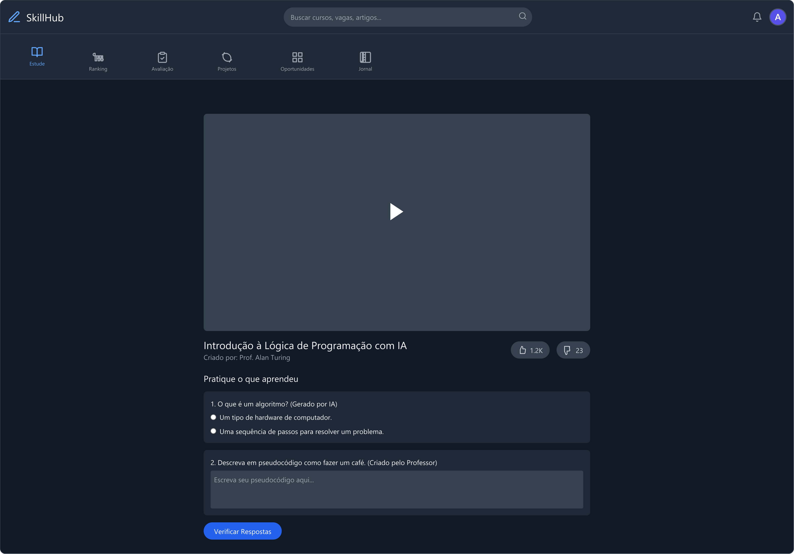
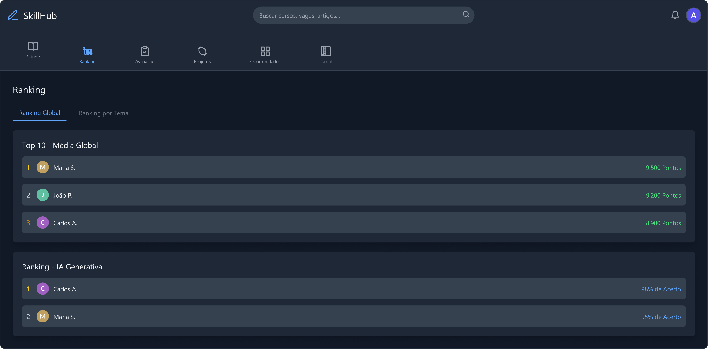
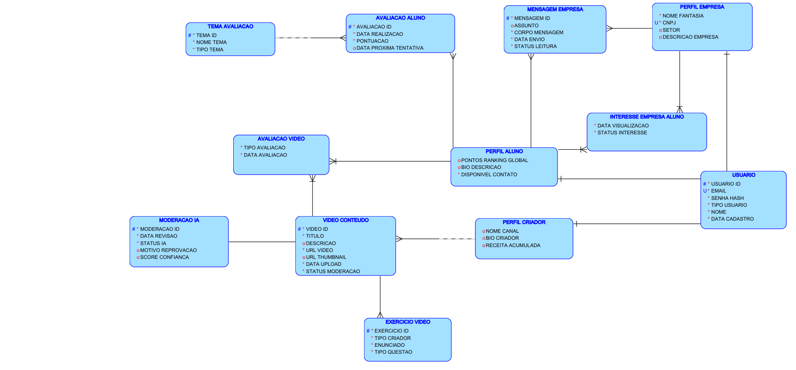
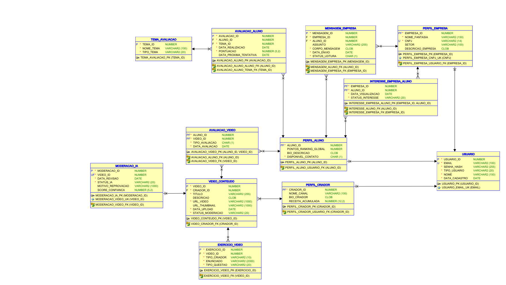

# Projeto SkillHub — Global Solution FIAP

**Autor:** Renan Santa Rosa Xavier — RM566997

---

## 🎬 Vídeo de Apresentação (Pitch Global Solution)

Assista ao pitch e demonstração completa da plataforma SkillHub no YouTube:

> 🔗 **Assistir no YouTube:** [Projeto SkillHub — Global Solution FIAP](https://www.youtube.com/watch?v=YsNf0N--3XQ)

---

## Sobre o Projeto

O **SkillHub** é uma plataforma desenvolvida para a **Global Solution FIAP**, voltada à conexão estratégica entre talentos, capacitação profissional, avaliação de competências técnicas/comportamentais e empresas parceiras.

---

## Apresentação da Solução e Proposta de Valor

| Contexto e Problema | Solução SkillHub |
| :---: | :---: |
|  |  |

| Funcionalidades da Plataforma | Impacto e Diferenciais |
| :---: | :---: |
|  |  |

---

## Protótipo das Telas do SkillHub

| Tela Inicial & Acesso | Painel e Trilhas de Competências | Avaliação e Perfil Profissional |
| :---: | :---: | :---: |
|  |  |  |

---

## Modelagem de Banco de Dados (Oracle SQL Developer Data Modeler)

### Modelo Lógico Relacional

### Modelo Físico Relacional

---

## Estrutura do Repositório

- [`SQL do Proj SkillHub.dmd`](SQL%20do%20Proj%20SkillHub.dmd) e [`SQL do Proj SkillHub/`](SQL%20do%20Proj%20SkillHub): Projeto completo do **Oracle SQL Developer Data Modeler** contendo as entidades de `PERFIL_EMPRESA`, `TEMA_AVALIACAO`, usuários, trilhas e avaliações.
- [`Protótipo SkillHub.pdf`](Prot%C3%B3tipo%20SkillHub.pdf): Telas navegáveis de alta fidelidade da plataforma.
- [`Projeto SkillHub Modelo Logico.pdf`](Projeto%20SkillHub%20Modelo%20Logico.pdf) e [`Projeto SkillHub Modelo Fisco.pdf`](Projeto%20SkillHub%20Modelo%20Fisco.pdf): Diagramas exportados dos modelos lógico e físico.
- [`Apresentação do Projeto SkillHub.pdf.pdf`](Apresenta%C3%A7%C3%A3o%20do%20Projeto%20SkillHub.pdf.pdf): Pitch e apresentação executiva da Global Solution.
